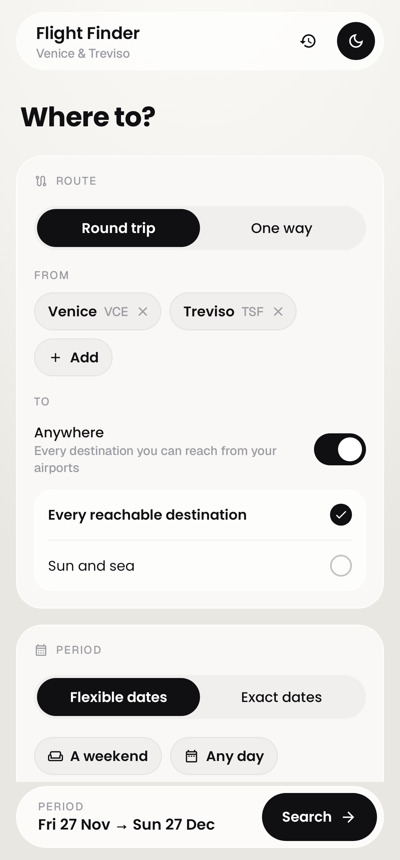
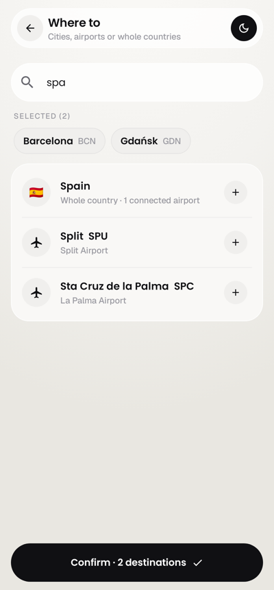
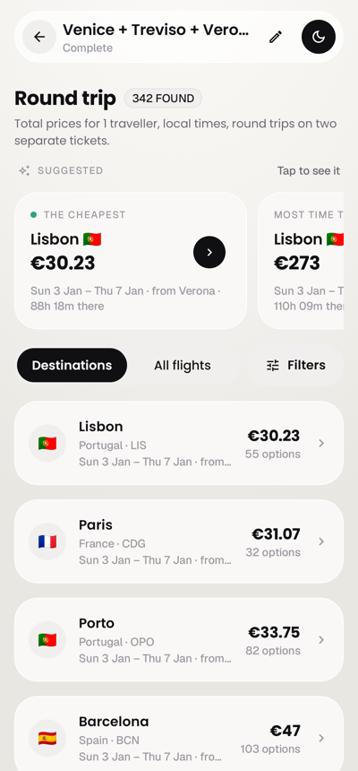
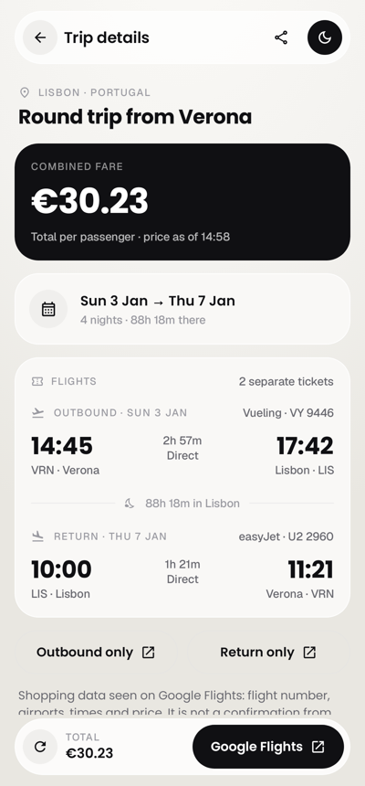
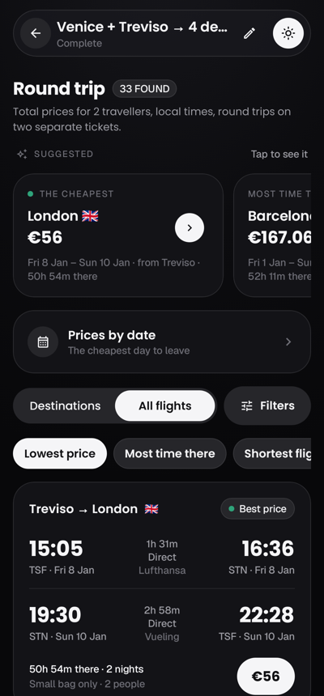
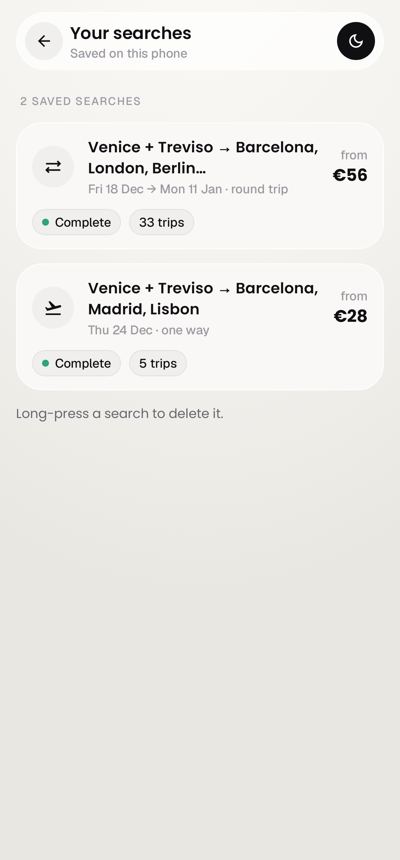
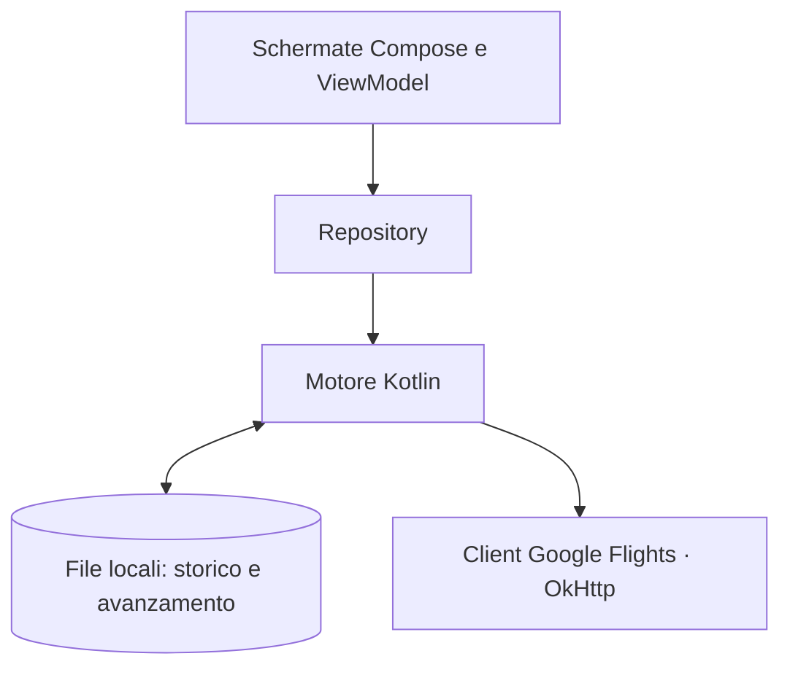

[English](README.md) · **Italiano**

<div align="center">

# ✈️ Flight Finder · Android

**Più aeroporti. Date flessibili. Il tuo prossimo viaggio, dal telefono.**

La ricerca voli di Flight Finder in un'app Android nativa, con motore Kotlin e interfaccia Jetpack Compose.


[Anteprima](#anteprima) · [Funzionalità](#funzionalità) · [Avvio rapido](#avvio-rapido) · [Architettura](#architettura) · [Test](#test) · [Limiti](#dati-e-limiti) · [Portale web](https://github.com/gzanee/Flight-Finder)

</div>

---

Flight Finder aiuta a confrontare viaggi con **date esatte o flessibili**, **sola andata o andata e ritorno**, da **più aeroporti** verso destinazioni specifiche oppure **Ovunque**.

Il motore gira sul dispositivo e le richieste a Google Flights partono dalla connessione del telefono: **non serve avviare il portale Python o un backend dedicato**. Il progetto riprende il motore del [portale web](https://github.com/gzanee/Flight-Finder), con test di confronto su casi di riferimento.

> **Scegli tu da dove partire.** Venezia (VCE) e Treviso (TSF) sono soltanto i valori precompilati per comodità dell'autore. Puoi rimuoverli e scegliere altri aeroporti italiani o internazionali presenti nel catalogo, cercandoli per nome, città o codice IATA.

## Anteprima

<table>
  <tr>
    <th>Ricerca</th>
    <th>Scelta degli aeroporti</th>
    <th>Destinazioni</th>
    <th>Dettaglio viaggio</th>
  </tr>
  <tr>
    <td><a href="docs/screenshots/1_ricerca.png"></a></td>
    <td><a href="docs/screenshots/2_aeroporti.png"></a></td>
    <td><a href="docs/screenshots/3_risultati_mete.png"></a></td>
    <td><a href="docs/screenshots/5_viaggio.png"></a></td>
  </tr>
</table>

*Gli screenshot mostrano una configurazione di esempio in inglese (l'app è in italiano e in inglese e segue la lingua del telefono): le origini non sono limitate a quelle visualizzate. Tocca un'immagine per aprirla a dimensione intera.*

<details>
<summary><strong>Tema scuro, storico e prova connessione</strong></summary>

<table>
  <tr>
    <th>Viaggi · tema scuro</th>
    <th>Storico</th>
    <th>Prova connessione</th>
  </tr>
  <tr>
    <td><a href="docs/screenshots/4_risultati_viaggi.png"></a></td>
    <td><a href="docs/screenshots/6_storico.png"></a></td>
    <td><a href="docs/screenshots/7_prova.png"></a></td>
  </tr>
</table>

</details>

## Funzionalità

| | Cosa puoi fare |
|---|---|
| 🌍 **Scegliere le mete** | Fino a **10 origini** e **200 destinazioni**, selezione per paese oppure **Ovunque**. |
| 📅 **Confrontare le date** | Date fisse o flessibili, sola andata o A/R, preset **Un weekend** e **Qualsiasi giorno**. |
| 🎛️ **Personalizzare il viaggio** | Filtri per orari, durate, scali, compagnie, bagagli, passeggeri e aeroporti del ritorno. |
| 🧭 **Scegliere tra le alternative** | Vista per destinazione o per viaggio, calendario dei prezzi e suggerimenti: più economico, più tempo a destinazione, miglior compromesso. |
| 💾 **Conservare le ricerche** | Storico locale, arresto e ripresa dei lavori senza perdere i viaggi già trovati. |
| 🔄 **Ricontrollare un'offerta** | Aggiornamento del prezzo e confronto con l'eventuale tariffa A/R unica. |
| 🔗 **Aprire e condividere** | Link all'offerta su Google Flights e condivisione del singolo viaggio. |
| 🌗 **Scegliere il tema** | Interfaccia chiara o scura, con preferenza salvata sul dispositivo. |

Il catalogo aeroporti e lo storico sono locali. **Per cercare voli o ricontrollare i prezzi serve una connessione Internet.**

### Un percorso semplice

1. **Scegli le origini**: per esempio Roma Fiumicino e Ciampino, oppure Madrid.
2. **Imposta la meta e le date**, o usa **Ovunque** per esplorare le possibilità.
3. **Esamina il piano e avvia la ricerca**; i risultati arrivano progressivamente.
4. **Confronta le alternative**, ricontrolla il viaggio scelto e apri l'offerta.
5. **Ritrova la ricerca nello storico** per consultarla o riprenderla.

Per una ricerca lunga puoi prima usare **Prova connessione**: esegue una singola ricerca reale e mostra la risposta ricevuta da Google. Durante una ricerca attiva l'app mantiene lo schermo acceso.

## Avvio rapido

### Da Android Studio

1. Clona il repository e apri la cartella con **Android Studio → Open**.
2. Lascia completare la sincronizzazione Gradle e l'installazione degli SDK richiesti.
3. Seleziona un emulatore o un dispositivo con debug USB attivo e premi **Run**.

**Requisiti del progetto:** Android **8.0+** (`minSdk 26`), SDK di compilazione e destinazione **36**. I valori correnti sono in [app/build.gradle.kts](app/build.gradle.kts); le versioni delle dipendenze sono in [gradle/libs.versions.toml](gradle/libs.versions.toml).

### Generare un APK

Dalla cartella del progetto:

```bash
./gradlew :app:assembleRelease
```

L'APK viene generato in **`app/build/outputs/apk/release/`**.

La configurazione attuale firma anche la variante release con la **chiave di debug**, per l'installazione di prova. Per una distribuzione definitiva va configurata una propria chiave di firma.

Su Windows usa `gradlew.bat` al posto di `./gradlew`.

## Architettura

Un solo modulo **`:app`**, con separazione tra **UI, dominio e dati**. Il motore di ricerca è in Kotlin e la UI usa ViewModel, Navigation Compose e componenti riutilizzabili.



Le richieste verso Google partono direttamente dal dispositivo; non passano dal portale web.

| Ambito | Tecnologie e responsabilità |
|---|---|
| **Interfaccia** | Jetpack Compose, Material 3, Navigation Compose, anteprime con `@DevicePreview`. |
| **Stato e attività** | ViewModel, Coroutines e Flow; esecuzione seriale del lavoro di ricerca. |
| **Dipendenze** | Hilt e moduli dedicati. |
| **Rete e serializzazione** | OkHttp e Kotlin Serialization; costruzione delle query e lettura delle risposte Google. |
| **Persistenza** | File JSON per i lavori; DataStore per il consenso e la preferenza del tema. |
| **Verifica** | JUnit e fixture generate dal motore Python di riferimento. |

### Organizzazione del codice

Package principale: **`it.gzanee.flightfinder`**, in [app/src/main/java/it/gzanee/flightfinder](app/src/main/java/it/gzanee/flightfinder).

| Cartella | Contenuto |
|---|---|
| `domain/model` | Richieste, voli, viaggi, piani, lavori e pagine di risultati. |
| `domain/repository` | Contratti per ricerche, catalogo, persistenza e tema. |
| `domain/search` | Motore Kotlin: validazione, pianificazione, combinazione delle tratte, filtri e avanzamento. |
| `data/google` | Query, lettura delle risposte, client HTTP, consenso, cache e gestione dei blocchi. |
| `data/storage` | Storico delle ricerche in file JSON e cookie di consenso in DataStore. |
| `data/repository` | Implementazioni dei repository e gestione del tema. |
| `data/di` | Moduli Hilt e dipendenze del progetto. |
| `ui/navigation` | Navigation Compose e destinazioni di navigazione. |
| `ui/screens` | Ricerca, aeroporti, risultati, dettaglio viaggio, storico e diagnostica. |
| `ui/components · ui/format · ui/preview · ui/theme` | Componenti condivisi, formattazione, anteprime e tema chiaro/scuro. |

Ogni schermata distingue il componente collegato al ViewModel (`XxxScreen`) dal contenuto di presentazione (`XxxScreenContent`), dove previsto, per favorire anteprime e riuso.

<details>
<summary><strong>I componenti del motore e i dati condivisi con il portale</strong></summary>

| Componente | Responsabilità |
|---|---|
| `AirportCatalog` | Aeroporti, paesi, rotte e autocomplete. |
| `Validation` | Controlli sulla richiesta e messaggi di errore. |
| `Planner` | Coppie di date, gruppi di aeroporti e piano delle richieste. |
| `Matching` | Verifica delle tratte e composizione dei viaggi A/R. |
| `ResultBrowser` | Filtri, gruppi, suggerimenti e calendario. |
| `SearchRunner` | Esecuzione, avanzamento, ripresa e ricontrollo. |

- [data/catalog](data/catalog): aeroporti, compagnie, rotte e paesi esportati dal portale e inclusi negli asset dell'app.
- [data/fixtures](data/fixtures): casi di riferimento usati nei test.
- [tools](tools): script per rigenerare catalogo e fixture.

L'app utilizza uno **snapshot del catalogo** del portale: non aggiorna le rotte da Wikipedia durante l'uso.

</details>

## Test

Per eseguire i test unitari:

```bash
./gradlew :app:testDebugUnitTest
```

La suite confronta il motore Kotlin con casi di riferimento generati dal portale Python: richieste, parsing delle risposte, risultati, filtri e comportamento della ricerca.

<details>
<summary><strong>Copertura dei casi di riferimento e rigenerazione delle fixture</strong></summary>

Sono test JUnit che confrontano il motore con il portale, su casi generati dal
portale stesso (`tools/golden_*.py`, già salvati in `data/fixtures`):

- le richieste tfs sono identiche byte per byte;
- le pagine Google sintetiche coprono difetti e casi limite: orari ambigui al
  cambio dell'ora, compagnie e aeroporti sconosciuti, valute, involucri vuoti
  o rotti. C'è anche una pagina reale catturata da una connessione di casa;
- 8 ricerche complete contro un Google finto danno le stesse richieste, gli
  stessi viaggi, gli stessi prezzi e le stesse viste dei risultati;
- 300 insiemi casuali di viaggi coprono filtri, ordinamenti e suggerimenti;
- validazione delle richieste (messaggi d'errore compresi), autocomplete e paesi;
- comportamento di rete: blocchi, ripetizioni, consenso, cache e ricontrollo.

Se cambi il motore del portale, lancia `bash tools/golden.sh` per rigenerare i
casi. Lo script cerca il portale con il suo `.venv` in `../flight-finder`,
oppure dove indica `FLIGHT_FINDER_PORTAL`; con l'argomento `dati` riesporta
anche il catalogo. Poi porta la stessa modifica in `domain/search`: i test
diranno dove i due divergono.

</details>

## Dati e limiti

### Prezzi e disponibilità

L'app legge quotazioni da Google Flights: **non è una conferma diretta della compagnia e non effettua prenotazioni**. Prezzo, disponibilità e condizioni vanno ricontrollati sull'offerta prima dell'acquisto.

Il totale A/R mostrato dal motore combina due tratte di sola andata. Il confronto con una tariffa A/R unica è un'indicazione separata: non va confuso con il prezzo dei due voli visualizzati.

### Aeroporti e modalità Ovunque

Gli aeroporti di partenza sono configurabili: Venezia e Treviso non limitano la ricerca. **Ovunque**, invece, parte dai cataloghi e dagli insiemi di destinazioni disponibili, che **non garantiscono copertura esaustiva** di tutte le rotte. Puoi selezionare destinazioni esplicite anche fuori da quel bacino.

### Esecuzione in background

Android può interrompere il processo quando l'app passa in background. In quel caso il lavoro compare come **Interrotto** nello storico e può ripartire con **Riprendi**, conservando i viaggi già trovati. L'app non promette ricerche continuative in background.

### Blocchi e consenso

- Una risposta **403/429** interrompe la ricerca e attiva una pausa di **15 minuti**.
- Reti aziendali, VPN e condizioni della connessione possono influenzare l'accesso; non è garantita l'assenza di blocchi.
- Il client gestisce il consenso cookie con il valore **“Rifiuta tutto”** e ripete l'handshake quando necessario, seguendo il comportamento del portale.

### Differenze rispetto al portale web

| Funzione | App Android |
|---|---|
| Ricerca, risultati, filtri, calendario e ricontrollo | Disponibili nell'app. |
| Esportazione PDF | Non inclusa; il singolo viaggio può essere condiviso. |
| Aggiornamento rotte da Wikipedia | Non incluso; viene usato il catalogo esportato. |
| Loghi delle compagnie | Non inclusi. |

Il progetto è in sviluppo ed è pensato per uso personale e sperimentazione. Per provarlo, installa l'app da Android Studio oppure genera l'APK.

## Il progetto

Questa app porta sul telefono il motore del [portale Flight Finder](https://github.com/gzanee/Flight-Finder), senza richiederne l'esecuzione. È un progetto personale in sviluppo, realizzato anche con il supporto di agenti AI.

