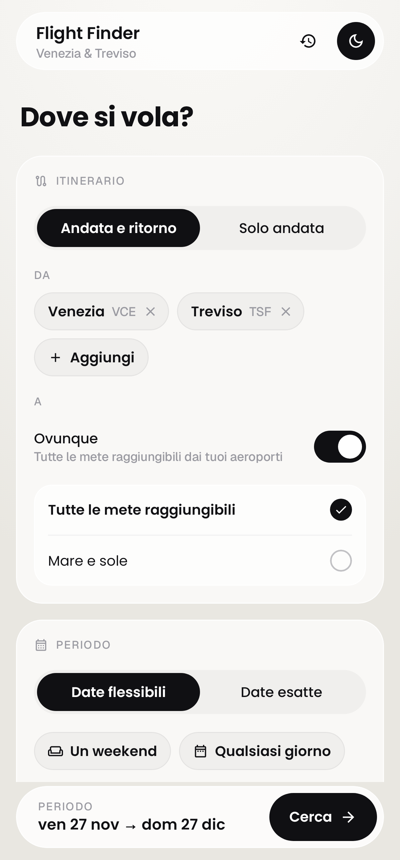
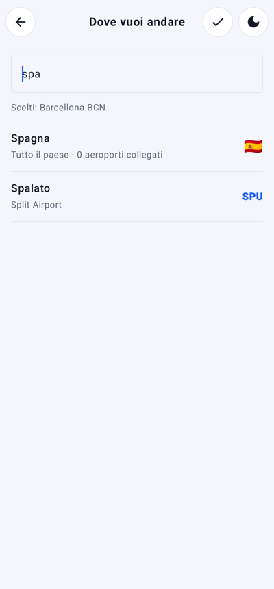
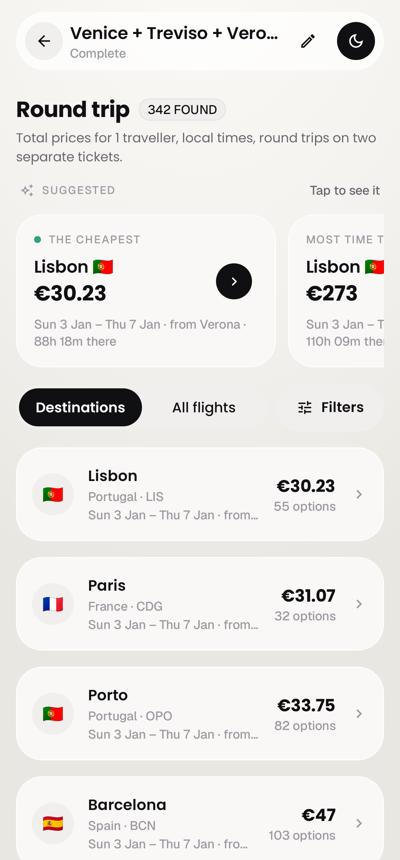
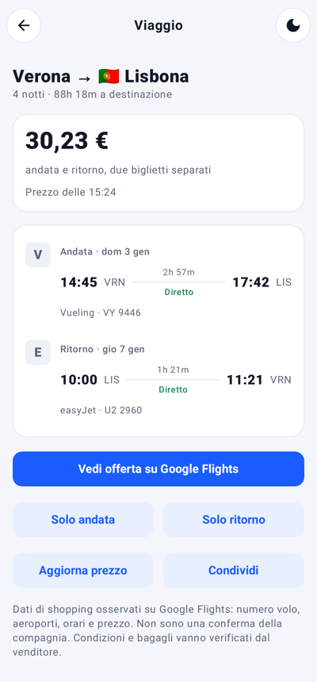
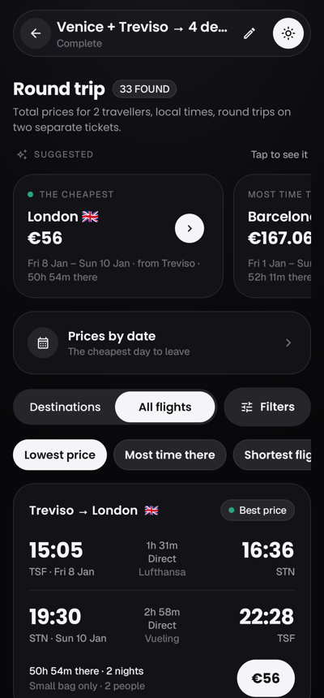
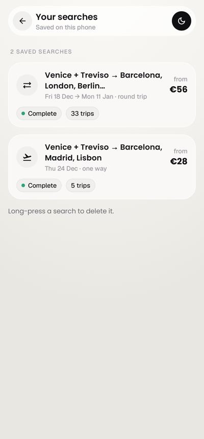
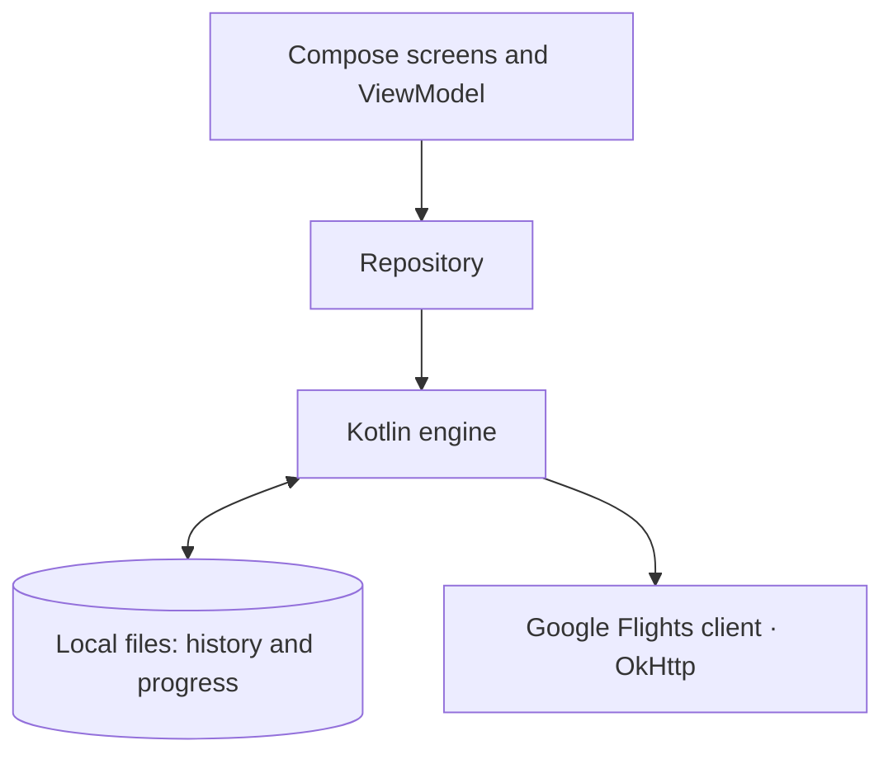

<div align="center">

# ✈️ Flight Finder · Android

**More airports. Flexible dates. Your next trip, from your phone.**

Flight Finder's flight search in a native Android app, with a Kotlin engine and a Jetpack Compose interface.


**English** · [Italiano](README.it.md)

[Preview](#preview) · [Features](#features) · [Quick start](#quick-start) · [Architecture](#architecture) · [Tests](#tests) · [Limitations](#data-and-limitations) · [Web app](https://github.com/gzanee/Flight-Finder)

</div>

---

Flight Finder helps you compare trips with **exact or flexible dates**, **one-way or round-trip itineraries**, from **multiple airports** to specific destinations or **Anywhere** ("Ovunque" in the current Italian interface).

The engine runs on the device and Google Flights requests use the phone's connection: **there is no need to run the Python web app or a dedicated backend**. The project ports the [web app's](https://github.com/gzanee/Flight-Finder) engine, with parity tests against reference cases.

> **Choose where you fly from.** Venice (VCE) and Treviso (TSF) are simply the author's convenient defaults. You can remove them and choose other Italian or international airports in the catalog, searching by name, city or IATA code.

## Preview

<table>
  <tr>
    <th>Search</th>
    <th>Airport selection</th>
    <th>Destinations</th>
    <th>Trip details</th>
  </tr>
  <tr>
    <td><a href="docs/screenshots/1_ricerca.png"></a></td>
    <td><a href="docs/screenshots/2_aeroporti.png"></a></td>
    <td><a href="docs/screenshots/3_risultati_mete.png"></a></td>
    <td><a href="docs/screenshots/5_viaggio.png"></a></td>
  </tr>
</table>

*Screenshots show an example configuration in the current Italian interface: origins are not limited to those shown. Select an image to view it at full size.*

<details>
<summary><strong>Dark theme, history and connection test</strong></summary>

<table>
  <tr>
    <th>Trips · dark theme</th>
    <th>History</th>
    <th>Connection test</th>
  </tr>
  <tr>
    <td><a href="docs/screenshots/4_risultati_viaggi.png"></a></td>
    <td><a href="docs/screenshots/6_storico.png"></a></td>
    <td><a href="docs/screenshots/7_prova.png"></a></td>
  </tr>
</table>

</details>

## Features

| | What you can do |
|---|---|
| 🌍 **Choose destinations** | Up to **10 origins** and **200 destinations**, country selection or **Anywhere**. |
| 📅 **Compare dates** | Fixed or flexible dates, one-way or round-trip searches, **A weekend** ("Un weekend") and **Any day** ("Qualsiasi giorno") presets. |
| 🎛️ **Customize your trip** | Filters for times, durations, stops, airlines, baggage, passengers and return airports. |
| 🧭 **Choose between options** | Destination or trip views, price calendar and suggestions: cheapest, most time at destination and best trade-off. |
| 💾 **Keep your searches** | Local history, with stop and resume support without losing trips already found. |
| 🔄 **Recheck an offer** | Refresh prices and compare with a single round-trip fare when available. |
| 🔗 **Open and share** | Open the offer on Google Flights and share an individual trip. |
| 🌗 **Choose your theme** | Light or dark interface, with the preference saved on the device. |

The airport catalog and search history are local. **Searching flights or rechecking prices requires an Internet connection.**

### A simple workflow

1. **Choose your origins**: for example, Rome Fiumicino and Ciampino, or Madrid.
2. **Set your destination and dates**, or use **Anywhere** to explore options.
3. **Review the plan and start searching**; results arrive progressively.
4. **Compare options**, recheck your chosen trip and open the offer.
5. **Find the search in your history** to view it or resume it.

Before a long search, you can use **Connection test** ("Prova connessione"): it runs a single real search and shows Google's response. The app keeps the screen awake during an active search.

## Quick start

### From Android Studio

1. Clone the repository and open the folder with **Android Studio → Open**.
2. Let Gradle sync and install the required SDKs.
3. Select an emulator or a device with USB debugging enabled and press **Run**.

**Project requirements:** Android **8.0+** (`minSdk 26`), compile and target SDK **36**. Current values are in [app/build.gradle.kts](app/build.gradle.kts); dependency versions are in [gradle/libs.versions.toml](gradle/libs.versions.toml).

### Build an APK

From the project directory:

```bash
./gradlew :app:assembleRelease
```

The APK is generated in **`app/build/outputs/apk/release/`**.

The current configuration also signs the release variant with the **debug key** for test installations. Configure your own signing key for final distribution.

On Windows, use `gradlew.bat` instead of `./gradlew`.

## Architecture

A single **`:app`** module separates **UI, domain and data**. The search engine is written in Kotlin; the UI uses ViewModel, Navigation Compose and reusable components.



Requests to Google go directly from the device; they do not pass through the web app.

| Area | Technologies and responsibilities |
|---|---|
| **Interface** | Jetpack Compose, Material 3, Navigation Compose, previews with `@DevicePreview`. |
| **State and execution** | ViewModel, Coroutines and Flow; serial execution of search jobs. |
| **Dependencies** | Hilt and dedicated modules. |
| **Networking and serialization** | OkHttp and Kotlin Serialization; query construction and Google response parsing. |
| **Persistence** | JSON files for jobs; DataStore for consent and theme preferences. |
| **Verification** | JUnit and fixtures generated by the reference Python engine. |

### Code organization

Main package: **`it.gzanee.flightfinder`**, in [app/src/main/java/it/gzanee/flightfinder](app/src/main/java/it/gzanee/flightfinder).

| Directory | Contents |
|---|---|
| `domain/model` | Requests, flights, trips, plans, jobs and result pages. |
| `domain/repository` | Contracts for searches, catalog, persistence and theme. |
| `domain/search` | Kotlin engine: validation, planning, flight matching, filters and progress. |
| `data/google` | Queries, response parsing, HTTP client, consent, cache and block handling. |
| `data/storage` | Search history in JSON files and consent cookies in DataStore. |
| `data/repository` | Repository implementations and theme management. |
| `data/di` | Hilt modules and project dependencies. |
| `ui/navigation` | Navigation Compose and navigation destinations. |
| `ui/screens` | Search, airports, results, trip details, history and diagnostics. |
| `ui/components · ui/format · ui/preview · ui/theme` | Shared components, formatting, previews and light/dark themes. |

Where applicable, each screen separates the ViewModel-connected component (`XxxScreen`) from its presentation content (`XxxScreenContent`) to support previews and reuse.

<details>
<summary><strong>Engine components and data shared with the web app</strong></summary>

| Component | Responsibility |
|---|---|
| `AirportCatalog` | Airports, countries, routes and autocomplete. |
| `Validation` | Request checks and error messages. |
| `Planner` | Date pairs, airport groups and request planning. |
| `Matching` | Flight checks and round-trip matching. |
| `ResultBrowser` | Filters, groups, suggestions and calendar. |
| `SearchRunner` | Execution, progress, resume and rechecks. |

- [data/catalog](data/catalog): airports, airlines, routes and countries exported from the web app and bundled in the Android app's assets.
- [data/fixtures](data/fixtures): reference cases used in tests.
- [tools](tools): scripts to regenerate the catalog and fixtures.

The app uses a **snapshot of the web app's catalog**: it does not refresh routes from Wikipedia at runtime.

</details>

## Tests

To run unit tests:

```bash
./gradlew :app:testDebugUnitTest
```

The suite compares the Kotlin engine with reference cases generated by the Python web app: requests, response parsing, results, filters and search behavior.

<details>
<summary><strong>Reference-case coverage and fixture regeneration</strong></summary>

JUnit tests compare the engine against cases generated by the web app
(`tools/golden_*.py`, already saved in `data/fixtures`):

- tfs requests are byte-for-byte identical;
- synthetic Google pages cover failures and edge cases: ambiguous times
  around daylight-saving changes, unknown airlines and airports, currencies,
  and empty or malformed response wrappers. There is also a real page
  captured using a home connection;
- 8 complete searches against a fake Google service produce the same
  requests, trips, prices and result views;
- 300 random sets of trips cover filters, sorting and suggestions;
- request validation (including error messages), autocomplete and countries;
- network behavior: blocks, retries, consent, cache and rechecks.

When changing the web engine, run `bash tools/golden.sh` to regenerate cases.
The script looks for the web app and its `.venv` in `../flight-finder`,
or at `FLIGHT_FINDER_PORTAL`; the `dati` argument also re-exports the catalog.
Then port the same change to `domain/search`: tests identify where the
two implementations diverge.

</details>

## Data and limitations

### Prices and availability

The app reads Google Flights quotes: **these are not direct airline confirmations, and the app does not make bookings**. Recheck prices, availability and conditions on the offer before purchasing.

The engine's displayed round-trip total combines two one-way flights. The comparison with a single round-trip fare is a separate indication; it is not the price of the two displayed flights.

### Airports and Anywhere mode

Departure airports are configurable: Venice and Treviso do not restrict searches. **Anywhere**, however, uses the available catalogs and destination sets, which **do not guarantee exhaustive coverage** of every route. You can select explicit destinations outside that pool.

### Background execution

Android may terminate the process when the app moves to the background. The job then appears as **Interrupted** ("Interrotto") in the history and can restart with **Resume** ("Riprendi"), retaining trips already found. The app does not promise continuous background searches.

### Blocks and consent

- A **403/429** response interrupts the search and triggers a **15-minute** pause.
- Corporate networks, VPNs and connection conditions may affect access; freedom from blocks is not guaranteed.
- The client handles cookie consent with **"Reject all"** and repeats the handshake when needed, following the web app's behavior.

### Differences from the web app

| Feature | Android app |
|---|---|
| Search, results, filters, calendar and rechecks | Available in the app. |
| PDF export | Not included; individual trips can be shared. |
| Wikipedia route updates | Not included; uses the exported catalog. |
| Airline logos | Not included. |

The project is in development and intended for personal use and experimentation. To try it, install from Android Studio or build the APK.

## About the project

This app brings the [Flight Finder web app's](https://github.com/gzanee/Flight-Finder) engine to your phone without requiring the web app to run. It is a personal project in development, built with support from AI coding agents.
